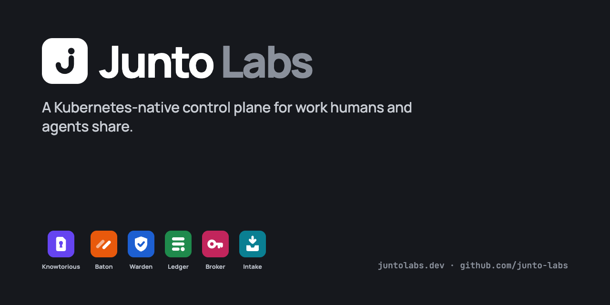

  

**Junto** is a Kubernetes-native control plane for work that humans and agents share, with a verifiable record of who did what and under whose authority. It's named after Benjamin Franklin's club of makers, who met to improve each other's work.

Junto is built from small, single-purpose components. Each one runs standalone and connects to the others through files, JSON, events and agent protocols (MCP today).

| Component | What it does | Status |
|---|---|---|
| **Knowtorious** | Scoped, access-controlled knowledge: agents fetch only the entries their contract allows | Phase 1, in progress |
| **Baton** | Workflow definitions and run state, with gates judged by the engine rather than the actor | Phase 2, planned |
| **Warden** | Policy decisions, trust records and autonomy bindings | Planned |
| **Ledger** | Signed evidence and an append-only audit trail | Planned |
| **Broker** | The only holder of write credentials; performs side effects | Planned |
| **Intake** | Pulls work items from GitHub, Linear, Jira and support desks | Planned |
| **junto-spec** | The shared JSON Schema vocabulary | — |

**Start here:** [Junto Community Edition](https://github.com/junto-labs/junto) (free to use) · [juntolabs.dev](https://www.juntolabs.dev)
